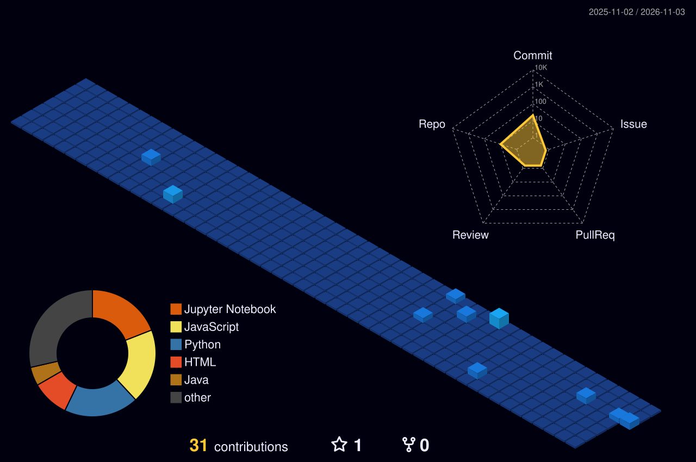

  

## 💫 About Me
- 🎓 Final-year B.Tech CSE (Data Science) student at Malla Reddy University, Hyderabad (2023–2027)
- 💻 Aspiring Full Stack Developer | Java | React | Node.js | MERN
- 📊 Interested in Data Science & Business/Revenue Analytics
- 🌱 Currently building an Airline Passenger Sentiment Analysis project using LSTM + Word2Vec
- 📫 Reach me on [LinkedIn](https://linkedin.com/in/sony-sharon-74b168253)

## 🚀 Projects
| Project | What it is |
|---|---|
| Digital Wallet & P2P Payments Platform | Wallet with peer-to-peer transfers |
| Stock Trading App | Buy/sell flow with live-style portfolio |
| Real-Time Chat App | Instant messaging with live updates |
| AI-Powered Weather Forecasting App | ML-based forecasts |
| Airline Passenger Sentiment Analysis | LSTM + Word2Vec on passenger reviews |

## 📊 GitHub Stats

  
  

  

## 🌃 Contribution City

